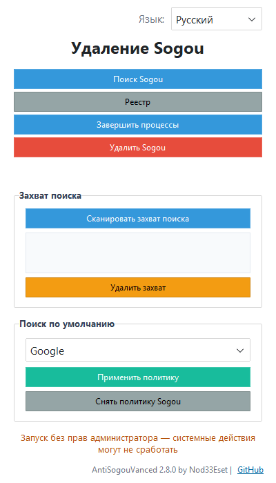

# AntiSogou Vanced

[](https://github.com/retvil/AntiSogouVanced/releases) [](https://github.com/retvil/AntiSogouVanced/releases) [](https://www.python.org/)

**Sogou Browser'ı tamamen kaldırın ve varsayılan aramanızı ele geçirmeye karşı kilitleyin — 40 tespit vektörü, 10 arama motoru, 10 arayüz dili.**

[🇬🇧 English](README.md) | [🇷🇺 Русский](README.ru.md) | [🇺🇦 Українська](README.uk.md) | [🇰🇿 Қазақша](README.kk.md) | [🇩🇪 Deutsch](README.de.md) | [🇫🇷 Français](README.fr.md) | [🇪🇸 Español](README.es.md) | [🇵🇱 Polski](README.pl.md) | **🇹🇷 Türkçe** | [🇨🇳 中文](README.zh.md)

## Bu nedir?

Sogou yalnızca bir tarayıcı kurmaz — kırk farklı sistem mekanizmasıyla sessizce varsayılan arama ve tarayıcı olarak kaydolur: kayıt defteri ilişkilendirmeleri, enterprise ilkeleri, tarayıcı profil ayarları, hatta Chromium profillerinin içindeki arama motoru veritabanları. Tarayıcıyı tek başına kaldırmak bunların hepsini geri almaz.

**AntiSogou Vanced** ([TheCawa/AntiSogou](https://github.com/TheCawa/AntiSogou) çatalı) **40 ele geçirme vektörünün tamamını** bulur, tek tıkla kaldırır ve ardından varsayılan aramanızı seçtiğiniz arama motoruna Windows enterprise ilkeleriyle **sabit şekilde kilitler** — hiçbir şey sessizce geri alamasın diye.

## Özellikler

- **Ele geçirme tarayıcısı** — 40 vektörü tespit eder: kurulum yolları, kayıt defterindeki Uninstall girdileri, `UserChoice` ilişkilendirmesi, `StartMenuInternet` kayıtları, `Software\Sogou` anahtar ağaçları, `DefaultSearchProvider*` ilkeleri üzerinden ele geçirme, Chromium profillerinin `Preferences` ayarları, `Web Data` (SQLite) anahtar kelimeleri, Firefox `search.json.mozlz4`, legacy `SearchScopes`, autostart girdileri, zamanlanmış görevler, Windows hizmetleri, IME Switcher, dosya ilişkilendirmeleri, Sogou Disk kabuk entegrasyonu, devre dışı otostart, App Paths, kısayollar, ProgramData/Roaming kalıntıları, hosts girdileri, güvenlik duvarı kuralları, URI protokolleri, tarayıcı eklentileri, sogou.ru çerezleri, „birlikte aç“ ilişkilendirmeleri, Prefetch/WER izleri, Defender istisnaları, klavye düzenleri, IE başlangıç sayfası ele geçirmesi, başlangıç URL ilkeleri (`RestoreOnStartupURLs`), Firefox ana sayfası, IE bölge haritası, RegisteredApplications girdileri, MUICache izleri, %TEMP% yükleyicileri, Store uygulamaları (Sogou Music, Alice), ürün dizinleri, yerel veri dizinleri, Sogou.DNS
- **Tek tıkla kaldırma** — her vektörün kendi remover'ı vardır; kilitli veritabanları dürüstçe raporlanır, çökme yok
- **Sabit arama politikası** — varsayılan aramayı 10 arama motorundan birine (Google, Bing, DuckDuckGo, Brave Search, Startpage, Mojeek, Qwant, Ecosia, Yahoo, SearXNG) kilitler: Chrome, Edge, Brave, Vivaldi, Opera ve Sogou Browser için HKLM ilkeleri + Firefox/Waterfox için `policies.json`
- **Politika temizliği** — Sogou `DefaultSearchProvider*` değerlerini kayıt defterinden temizler
- **10 arayüz dili** — ru, en, uk, kk, de, fr, es, pl, tr, zh; sistem dili otomatik algılanır
- **Hafif arayüz** — ttkbootstrap, dikey düzen, sabitlenmiş durum çubuğu ve alt bilgi

## Ekran görüntüsü

<details>
<summary>Ana pencere</summary>



</details>

## Hazır derlemeler

[Releases](https://github.com/retvil/AntiSogouVanced/releases) sayfasından indirin:

- **Windows** — `AntiSogouVanced.exe` (taşınabilir, tek dosya, ~35 MB) — Sogou Browser ve Sogou Arama kaldırma
- **Windows** — `AntiSogouExtended.exe` (taşınabilir, tek dosya, ~35 MB) — tüm Sogou ürünlerinin kaldırılması (Sogou Disk, IME Switcher geçmişi, sistem genelinde izler, Store uygulamaları, Sogou.DNS)

**Yönetici olarak** çalıştırın — HKLM ilkeleri ve kayıt defteri temizliği yükseltilmiş haklar gerektirir.

## Kaynak koddan kurulum

Python 3.10+ gerekli ([python.org](https://python.org)).

```bash
git clone https://github.com/retvil/AntiSogouVanced.git
cd AntiSogouVanced
pip install psutil ttkbootstrap
python main.py
```

Kendi EXE'nizi derlemek için: `build.bat` çalıştırın (PyInstaller, çıktı `dist/` içinde).

## Kullanım

1. **İşlemleri sonlandır** → **Sogou'i ara** → **Sogou'i sil** — tarayıcının kendisini kaldırıyoruz.
2. **Arama ele geçirmelerini tara** — Sogou'in sisteme nasıl kök saldığının tüm yollarını gösterir.
3. **Ele geçirmeleri kaldır** — önce tüm tarayıcıları kapatın, sonra bulunan her şeyi kaldırın.
4. Bir motor seçin → **Politikayı uygula** — varsayılan arama sistem düzeyinde kilitlendi.

## SSS

- **Neden yönetici?** Arama politikaları HKLM'de yaşar, temizlik sistem kayıt defterine dokunur — yükseltilmiş haklar gerekir.
- **Sonuçlarda «Database locked»?** Temizlik sırasında bir Chromium tarayıcısı çalışıyordu. Tüm tarayıcıları kapatın ve kaldırmayı tekrarlayın.
- **Arama politikasını nasıl kaldırırım?** **Sogou politikalarını kaldır** düğmesi politika değerlerini temizler; Firefox'ta ayrıca `distribution\policies.json` dosyasını silebilirsiniz.

## Yazar ve destek

**Nod33Eset** — [TheCawa/AntiSogou](https://github.com/TheCawa/AntiSogou) çatalı. Issues ve PR'lara açığız.

Araç sizi Sogou'ten kurtardıysa, geliştirmeyi destekleyebilirsiniz:

**Kripto:**

- BTC: `bc1qunld3rsp37qf5gg69aune50y0qqkd0eugg7j97`
- TON: `UQDmvr4SKOxSION3Yky6aOgzAnCDXySPuAbG4EKJa5JUT7tC`
- USDT (TRC20): `TBPJSSLu1mUcX54g9UyxUohYGf2fuRvbwd`
- USDT (ERC20): `0x25CAED3776Ef5b18E03392bC5b254Bbd78E8180C`
- USDT (SOL): `3qgN5z291CEcj2FUi2Zza5DioxKgNw72kC7P52pCcTrG`

## Lisans

MIT — bkz. [LICENSE](LICENSE).
